# Claude Buddy

A tiny desk companion that shows what [Claude Code](https://claude.com/claude-code) is doing.
A small Bluetooth LE gadget with a retro OLED face: it dozes when nothing is happening, watches
intently while Claude works, grins when a turn finishes, and flashes when Claude needs *you*.

> **Inspired by [ClaudeMonitorCompanion](https://github.com/MilosRasic98/ClaudeMonitorCompanion)**
> by Milos Rasic: an ESP32 desk mascot with a mechanical bell that reacts to Claude Code hooks.
> This project takes that idea to Nordic Bluetooth LE hardware and an OLED face. See [Credits](#credits-and-license).

<table>
  <tr><td align="center">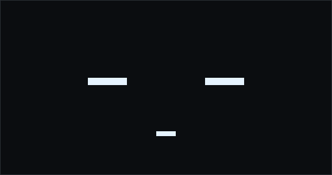<br><sub>asleep</sub></td><td align="center">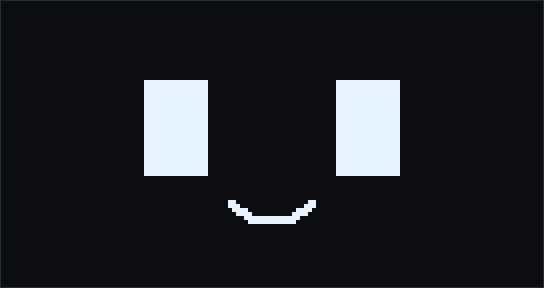<br><sub>chill</sub></td><td align="center">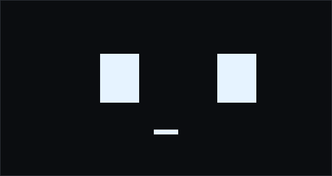<br><sub>working</sub></td><td align="center">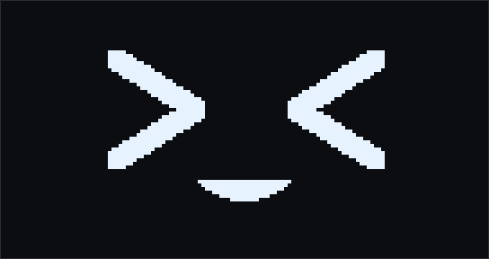<br><sub>turn finished</sub></td></tr>
  <tr><td align="center">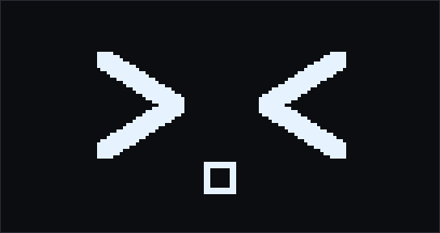<br><sub>needs you</sub></td><td align="center">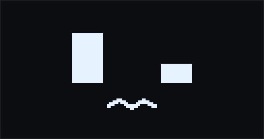<br><sub>confused (error)</sub></td><td align="center">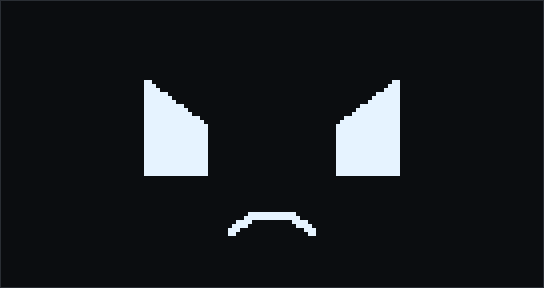<br><sub>angry (poked too much)</sub></td><td align="center"><br><sub>usage limit hit</sub></td></tr>
  <tr><td align="center">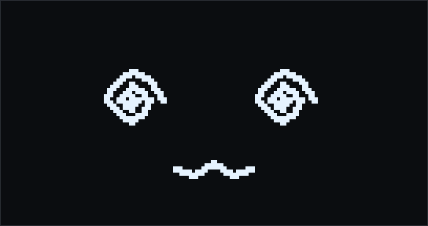<br><sub>dizzy (shaken)*</sub></td><td align="center">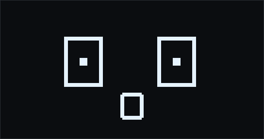<br><sub>scared (dropped)*</sub></td><td align="center"><br><sub>over budget</sub></td><td align="center">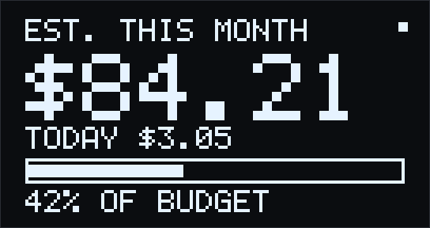<br><sub>stats page</sub></td></tr>
</table>

<sub>Drawn by the firmware's own code (<code>tools/render-faces.py</code>), pixel for pixel as on the 128x64 OLED.<br>
* Needs an accelerometer: only the XIAO nRF54LM20A <b>Sense</b> has one. On the plain XIAO these two faces never show.</sub>

* **Works with whatever machine runs Claude Code.** By default the buddy talks to the machine it
  sits next to. No broker, no cloud, no accounts.
* **Optional relay.** If Claude Code runs on another machine (a remote dev box, for example), or
  you want a second buddy at another desk that mirrors the first, the installer sets up a small MQTT relay.
* **Nine events, nine moods.** Driven by Claude Code *hooks*; see [docs/PROTOCOL.md](docs/PROTOCOL.md).
* **One installer.** `python3 install.py` asks a few questions and does the rest, including starting
  automatically at login.

## Quick start

You need three things: the hardware, the firmware on it, and the installer on your computer.

**1. Hardware** (about an hour, most of it soldering; step by step in [docs/BRINGUP.md](docs/BRINGUP.md))

* A **Seeed XIAO nRF54LM20A** (get the Sense variant if you want gestures: its accelerometer is needed for the dizzy and scared faces) with its antenna
* A **1.3" 128x64 SH1106 OLED** module with an I2C interface
* A passive piezo buzzer, two push buttons, and optionally a 150-200 mAh Li-Po cell
* Optionally the carrier board in [hardware/](hardware/) (Altium); parts and pins in [docs/HARDWARE.md](docs/HARDWARE.md)

**2. Firmware** ([docs/FIRMWARE.md](docs/FIRMWARE.md))

```bash
# nRF Connect SDK v3.5.0-preview3 or newer, installed with nrfutil sdk-manager
tools/new-signing-key.sh ~/ncs/v3.5.0-preview3                 # once; back the key up
tools/build-xiao.sh ~/ncs/v3.5.0-preview3 build ~/.config/claude-buddy/signing/claude-buddy-ed25519.pem
# first flash over the XIAO's USB-C port (run it twice on a new, locked board)
openocd -f openocd.cfg -c "init; reset halt; nrf54lm20a-load build/claude-buddy-xiao-all.hex; reset run; exit"
```

Later updates go over Bluetooth from the bridge's web page.

**3. Software** (Python 3.9+, any of Linux / macOS / Windows)

```bash
git clone https://github.com/espenrog/claude-buddy && cd claude-buddy
python3 install.py
```

Press Enter to accept the default (Claude Code and the buddy on the same computer), power the buddy, and restart any running Claude Code
session. That's it. If something doesn't work, `python3 install.py --doctor` finds out why.

## How it works

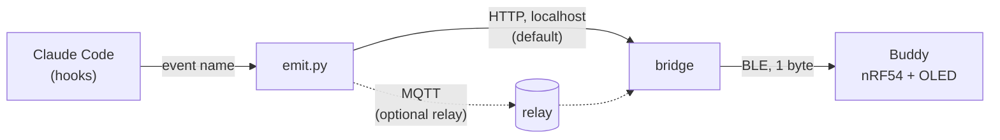

Claude Code runs a tiny command for each lifecycle event (prompt submitted, turn finished,
permission needed, ...). That command forwards the event name to a *bridge* program, which writes a
single byte over Bluetooth LE. The firmware turns the stream of events into a mood and draws the
face; it also keeps its own clock, so it gets bored and falls asleep by itself.
Details and more diagrams: [docs/ARCHITECTURE.md](docs/ARCHITECTURE.md).

## Documentation

| | |
|---|---|
| [docs/BRINGUP.md](docs/BRINGUP.md) | First bring-up of a new buddy (XIAO nRF54LM20A), step by step with checks |
| [docs/SETUP.md](docs/SETUP.md) | The installer, step by step, for each way of using it (one machine, remote Claude, second buddy) |
| [docs/ARCHITECTURE.md](docs/ARCHITECTURE.md) | What runs where, how data moves, security notes |
| [docs/HARDWARE.md](docs/HARDWARE.md) | Parts, pins, the XIAO's schematic and board-file quirks, battery, measured power |
| [docs/FIRMWARE.md](docs/FIRMWARE.md) | Building, the first flash, updates over Bluetooth, code layout |
| [docs/POWER-MEASUREMENT.md](docs/POWER-MEASUREMENT.md) | Measuring the current with a Power Profiler Kit |
| [docs/PROTOCOL.md](docs/PROTOCOL.md) | BLE service, event codes, mood rules |
| [docs/TROUBLESHOOTING.md](docs/TROUBLESHOOTING.md) | Every problem we ran into while building this, and the fix |
| [docs/ROADMAP.md](docs/ROADMAP.md) | Where the project is going, in stages |
| [docs/DEVELOPMENT.md](docs/DEVELOPMENT.md) | Branches, tags, rolling back, what must stay in step |

## Uninstall

```bash
python3 install.py --uninstall          # removes the hooks and the autostart entry
python3 install.py --uninstall --purge  # also deletes the config, files and relay
```

## Credits and license

This project exists because of [**ClaudeMonitorCompanion**](https://github.com/MilosRasic98/ClaudeMonitorCompanion)
by [Milos Rasic](https://github.com/MilosRasic98) (an ESP32-S3 desk mascot with a touch LCD and a mechanical bell).
Ideas taken from it:

* a physical desk gadget driven by **Claude Code hooks**, one hook per lifecycle event;
* the **mood vocabulary** (sleeping, chill, bored, working, excited, confused, angry, limit reached) and the
  rule that boredom and sleep are the *absence* of events, so the device keeps its own clock;
* the idea of a "needs you" state that stays on until you answer.

Everything here is an independent implementation on different hardware (Nordic nRF54 with a monochrome OLED),
with a different architecture (a Bluetooth LE bridge, an optional MQTT relay, a cross-platform installer).
No code, artwork or CAD files were copied. If you like the idea, go and look at the original: the 3D-printed mascot,
the bell mechanism and the touch interface are well worth seeing, and it is licensed on its own terms (see its repository).

The carrier board design in [hardware/](hardware/) includes schematic sheets of the
[Seeed Studio XIAO nRF54LM20A](https://wiki.seeedstudio.com/), from Seeed Studio's published design files, which are licensed
under [CC BY-SA 4.0](https://creativecommons.org/licenses/by-sa/4.0/). Those sheets, and the carrier design that adapts them,
are shared under the same license. The XIAO notes in [docs/HARDWARE.md](docs/HARDWARE.md) were checked against the same files.

## License

[GPL-3.0](LICENSE), the same license as the project that inspired this one, except the carrier board design in
[hardware/](hardware/), which is [CC BY-SA 4.0](https://creativecommons.org/licenses/by-sa/4.0/) (see
[Credits](#credits-and-license)).

Only the *source* is licensed this way. To build the firmware you install Nordic's nRF Connect SDK yourself, which has
its own license terms (and includes a proprietary Bluetooth controller library); do not redistribute the compiled
firmware without checking those terms.
