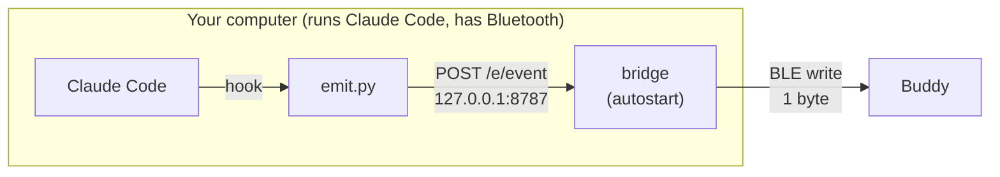
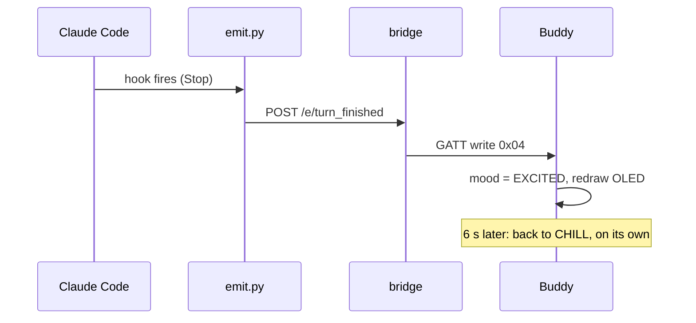
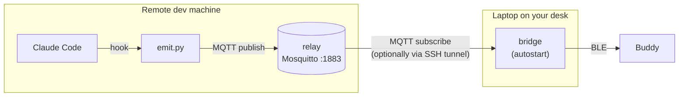
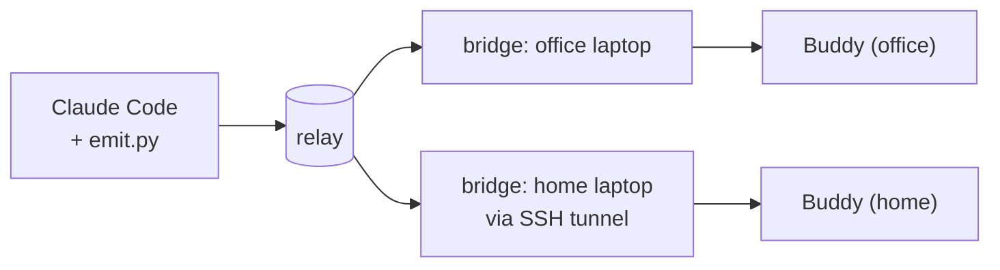
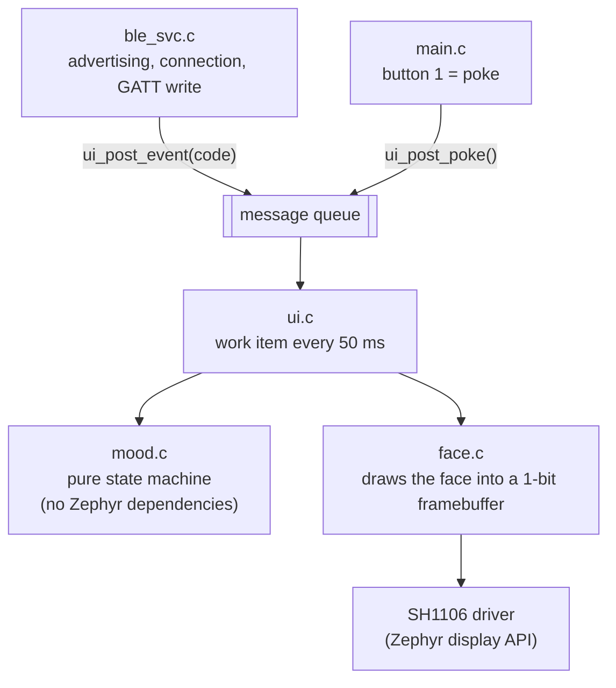

# Architecture

Claude Buddy has four moving parts. Which of them run where depends on how you set it up.

| Part | What it is | Runs on |
|---|---|---|
| **Hooks** | Entries in `~/.claude/settings.json` that run `emit.py` for each Claude Code event | The machine that runs Claude Code |
| **`emit.py`** | Sends one event name onward. Python standard library only; never fails loudly | The machine that runs Claude Code |
| **Relay** (optional) | An MQTT broker (Mosquitto in Docker) that fans events out to several bridges | Usually the machine that runs Claude Code |
| **Bridge** | Receives events (HTTP or MQTT) and writes one byte over BLE. Starts at login | The machine next to the buddy |
| **Firmware** | Turns events into a mood and draws the face | The buddy itself |

## 1. Default: everything on one machine

No broker, nothing exposed on the network. The bridge's HTTP port listens on `127.0.0.1` only.

## 2. Claude Code on another machine (relay)

Typical case: Claude Code runs on a remote dev box, but the buddy sits on your desk next to your laptop.
The Claude machine hosts a small MQTT relay. The laptop's bridge subscribes to it.

## 3. A second buddy that mirrors the first

Add another bridge. Every bridge subscribes to the same relay, so all buddies show the same thing.
Nothing about Claude's side changes.

The buddies stay in sync without any coordination: each runs the same mood logic on the same event
stream. (They can differ briefly for time-based moods such as *bored*, depending on when each was last reset.)

## Data path, byte by byte

| Hop | Format |
|---|---|
| Claude Code → `emit.py` | command line: `emit.py turn_finished` |
| `emit.py` → bridge (local) | HTTP `POST http://127.0.0.1:8787/e/turn_finished/<session_id>`, empty body |
| `emit.py` → relay | MQTT 3.1.1 PUBLISH, topic `claude-buddy/events`, payload = `event_name:session_id` (plain text) |
| relay → bridge | MQTT delivery of the same payload |
| bridge → buddy | one GATT write request, two bytes: event code and session slot (see [PROTOCOL.md](PROTOCOL.md)) |
| buddy → you | mood state machine + 128x64 framebuffer over I2C (400 kHz) |

## Firmware structure

`mood.c` takes time as an argument and has no OS dependencies, so it can be unit-tested on a host.

## Security notes

* **The bridge's HTTP port** (hook endpoint and web page) binds to `127.0.0.1` only. Other users on the same machine could post
  events or change settings; the effect is limited to the buddy's face and display. Against attacks through your own browser,
  every request must be addressed to `127.0.0.1` or `localhost` (blocks DNS rebinding), requests carrying a foreign `Origin`
  are refused (blocks other web sites), and anything under `/api/` that changes state needs a custom `X-Claude-Buddy` header,
  which a web page on another site cannot send. The page is served with a strict content security policy and loads nothing
  from the internet.
* **The relay** is password-protected, but MQTT is plain text. Run it on a trusted LAN or VPN, or reach
  it through the bridge's built-in SSH tunnel option. Do not expose port 1883 to the internet.
* **The buddy's BLE characteristic** requires no pairing. Anyone within radio range can change its face.
  It carries no data and controls nothing else.
* **Secrets** live in `~/.config/claude-buddy/config.json` (mode 600). Nothing is sent to any cloud service.
* **The installer** edits `~/.claude/settings.json`: it makes a timestamped backup first and only ever
  touches hook entries that it created.
