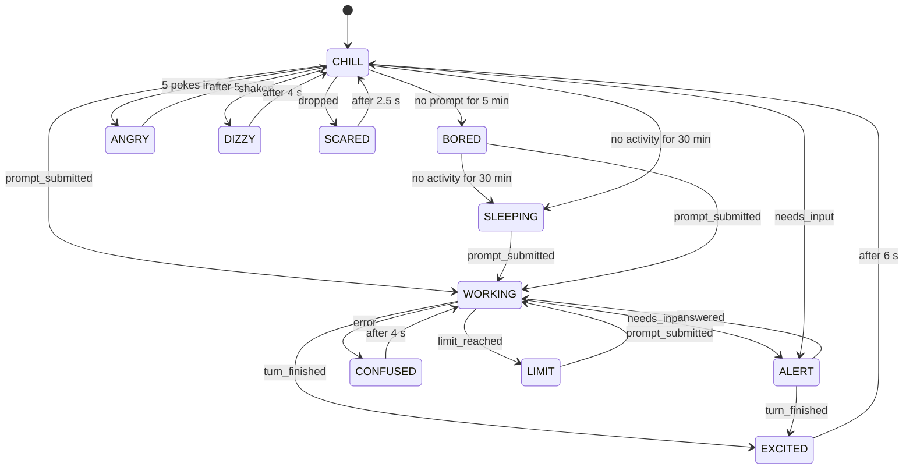

# Protocol

## BLE service

The buddy advertises as **Claude Buddy XXXX** (XXXX = the last two bytes of its device address in hex, e.g. `Claude Buddy A1B2`, so several buddies in range can be told apart; firmware before 0.8.10 advertised plain `Claude Buddy`) with one custom service. From firmware 0.8.10 the link must be paired: see [Pairing](#pairing).

| | UUID |
|---|---|
| Service | `6b1d0001-5c3a-4e5b-9b2a-6c1a0d0e0001` |
| Event characteristic (write, write-without-response) | `6b1d0002-5c3a-4e5b-9b2a-6c1a0d0e0001` |
| Version characteristic (read) | `6b1d0003-5c3a-4e5b-9b2a-6c1a0d0e0001` |
| Settings characteristic (read, write) | `6b1d0004-5c3a-4e5b-9b2a-6c1a0d0e0001` |
| Status characteristic (read, notify) | `6b1d0005-5c3a-4e5b-9b2a-6c1a0d0e0001` |
| Usage characteristic (write; firmware 0.4 and newer) | `6b1d0006-5c3a-4e5b-9b2a-6c1a0d0e0001` |
| Time characteristic (write; firmware 0.6 and newer) | `6b1d0007-5c3a-4e5b-9b2a-6c1a0d0e0001` |
| Battery characteristic (read, notify, test write; firmware 0.7 and newer) | `6b1d0008-5c3a-4e5b-9b2a-6c1a0d0e0001` |
| Battery log characteristic (read, write; firmware 0.8.7 and newer) | `6b1d000a-5c3a-4e5b-9b2a-6c1a0d0e0001` |
| Measurement mode characteristic (read, write; firmware 0.8.8 and newer) | `6b1d000b-5c3a-4e5b-9b2a-6c1a0d0e0001` |

Write **two bytes**: the event code and the *session slot* (0 to 7). The older one-byte form (code only, slot 0) is still accepted.
Any other length, or a slot above 7, is rejected with an ATT error. Only one central can be connected at a time. The bridge scans for the service UUID, so it finds the
buddy by itself. With several in range it takes the nearest one and warns; set `bridge.ble_name` in its config to the id (`"A1B2"`), the full name or the address to pick one.

## Pairing

From firmware 0.8.10 (Kconfig `BUDDY_REQUIRE_PAIRING`, on by default) only the version characteristic can be read on an
unencrypted link; every other characteristic needs a paired central. This keeps strangers in Bluetooth range from reading
your spending or changing the display. It uses LE Secure Connections, "Just Works" (no passkey, so it works on every
platform); the buddy keeps up to three pairings and replaces the oldest.

* The buddy accepts a **new** pairing only while its pairing window is open (the display shows `PAIRING`): for two minutes after
  boot while nothing is paired, or after holding the mute button for 3 seconds. A successful pairing closes the window
  (`PAIRED`). Holding the button for 8 seconds forgets all pairings, drops the link and opens the window.
* The bridge reads the version characteristic, sees capability bit 4, and tries the settings characteristic. If that is refused it
  asks the operating system to pair, then retries; it shows "Not paired yet" on the web page and tries again every 10 seconds
  while you open the window. Pairing is remembered by the operating system, and later connections encrypt with the stored key.
* Not covered: Just Works cannot stop someone who attacks exactly while the window is open. The buddy's name and the version
  characteristic stay readable.
* If the buddy was reflashed with a full erase, or you forgot its pairings, remove the old pairing in the operating system
  (Windows: Settings > Bluetooth, remove "Claude Buddy"; Linux: `bluetoothctl remove <address>`), or the bridge will fail to encrypt.

## Several sessions

You may run several Claude Code sessions at once (different projects, remote machines, sub-agents' parent sessions).
Claude Code gives every session an id, and the hooks pass it on, so the buddy can tell them apart:

* `emit.py` reads the `session_id` from the hook's input and sends it with the event: `POST /e/<event>/<session_id>` over
  HTTP, or the text `<event>:<session_id>` over MQTT. Events without an id still work and count as one session called "manual".
* The bridge assigns each session id one of 8 **slots**, keeps the assignment while the session lives, frees it on
  `session_ended`, and recycles the least recently used slot if more than 8 sessions appear (sending a reset first).
* The buddy keeps working / waiting state per slot. **Alert** shows if *any* session waits for you; **working** shows while
  *any* session works; the usage **limit** is account-wide and stops all of them.
* With two or more sessions the face shows one small square per session in the top left corner: blinking = waiting for
  you, solid = working, hollow = idle.
* A session that sends nothing for an hour is forgotten (a crashed session cannot hold an alert forever).

## Version characteristic

Reading it returns three to five bytes: **protocol version**, firmware major, firmware minor (for example `02 00 03`), from
firmware 0.8 a fourth byte of capability bits, and from firmware 0.8.4 a fifth byte with the firmware patch number (the bridge
and web page then show `0.8.4` instead of `0.8`). The capability bits: bit 0 = not used (reserved, like the UUID
`...0009`: an earlier board restarted into a firmware loader through them), bit 1 = the battery characteristic accepts simulated readings (builds without a real fuel gauge), bit 2 = the battery log characteristic exists (firmware 0.8.7), bit 3 = the measurement mode characteristic exists (firmware 0.8.8), bit 4 = everything but the version characteristic needs a paired, encrypted link (firmware 0.8.10), bit 5 = the application takes firmware updates itself over the SMP service (firmware 0.8.11). A bridge that sees only three bytes assumes
no capabilities, except that firmware 0.7 accepted simulated readings.
The bridge reads it after every connection and logs one of:

* `buddy: firmware 0.3, protocol 2`: all good. (Protocol 1 firmware, 0.2, still works but shows one combined state.)
* a warning that the firmware is older than 0.2 (it has no version characteristic): it still works.
* a warning that the protocol is newer or older than the bridge's: update the bridge (re-run `install.py`) or the firmware.

The protocol version is bumped whenever the GATT layout or the event codes change incompatibly; additions that old
firmware can ignore do not need a bump.

## Settings characteristic

Eight bytes, read or written as a whole. Invalid values are rejected with an ATT error and change nothing.
The buddy saves a change to its non-volatile memory two seconds later (so dragging a slider causes one write).

| Byte | Field | Valid values |
|---|---|---|
| 0 | format | `1` |
| 1 | `brightness`: display contrast while awake | 1 to 255 |
| 2 | `sleep_brightness`: contrast while the buddy sleeps | 0 (display off) to 255; default 8 (dim) |
| 3 | `face_profile`: eye style | 0 bars, 1 rounded, 2 rounded with a highlight |
| 4 | `volume`: buzzer volume, for hardware that has one | 0 to 100 |
| 5 | `quiet_start_h`: buzzer is silent from this hour... | 0 to 23 |
| 6 | `quiet_end_h`: ...until this hour (may wrap past midnight; equal values mean never) | 0 to 23 |
| 7 | flags | bit 0 = muted; other bits must be 0 |

While the display is off or dimmed for sleep, an event (or a poke) wakes it up again.

## Status characteristic

Five bytes, readable, and notified whenever they change (subscribe to it to follow the buddy live):

| Byte | Meaning |
|---|---|
| 0 | current mood: 0 sleeping, 1 chill, 2 bored, 3 working, 4 excited, 5 alert, 6 confused, 7 angry, 8 limit, 9 dizzy, 10 scared (9 and 10 only on boards with an accelerometer) |
| 1 | sessions the buddy knows about |
| 2 | ... of which are working |
| 3 | ... of which wait for you |
| 4 | flags: bit 0 = display is off, bit 1 = muted |

## Usage characteristic

Written by the bridge whenever the spending summary changes (and once after every connection). Invalid values
are rejected with an ATT error. Adding it did not change the protocol version: older bridges simply never write it.
The bridge picks the format from the firmware version it reads: format 1 for firmware 0.4, format 2 from 0.5.

| Byte | Meaning |
|---|---|
| 0 | format: `1` (3 bytes) or `2` (9 bytes) |
| 1 | flags: bit 0 = a monthly budget is set, bit 1 = spending passed the warning level (only with bit 0) |
| 2 | this month's spending as a percent of the budget, saturating at 255 (0 without a budget) |
| 3 to 6 | format 2 only: this month's estimated spending in cents, unsigned 32-bit little endian |
| 7 to 8 | format 2 only: today's estimated spending in cents, unsigned 16-bit little endian, saturating |

With bit 1 set the eyes become dollar signs (with a grin) while the buddy is chill, bored or working. The **stats page**
(the page button) shows the month, today and a budget bar for 15 seconds, then the face returns; a second press goes back at
once, and an alert or the limit always takes over. Firmware 0.4 drew the bar along the bottom of the face instead.

## Time characteristic

Three bytes: format `1`, hour (0 to 23), minute (0 to 59) of the bridge computer's local time. The buddy has no clock of its
own, so the bridge writes this after every connection and every 10 minutes; the buddy counts forward from it. It is used
only for the quiet hours. Until the first write the buddy does not know the time and does not stay silent. Invalid values
are rejected with an ATT error.

## Battery characteristic

Five bytes, eight from firmware 0.8.5 or nine from firmware 0.8.6, readable and notified when they change. The bridge shows them on the web page.

| Byte | Meaning |
|---|---|
| 0 | format: `1` |
| 1 | flags: bit 0 = a battery is present, bit 1 = charging, bit 2 = charged (plugged in, charge complete). Charging and charged exclude each other; without a battery all flags are 0 |
| 2 | charge in percent, 0 to 100 |
| 3 to 4 | cell voltage in millivolts, unsigned 16-bit little endian, 0 = unknown (at most 5000) |
| 5 to 6 | firmware 0.8.5 and newer: battery current in milliamperes, signed 16-bit little endian, positive = charging, negative = discharging; `00 80` = unknown (no power chip that measures it) |
| 7 | firmware 0.8.5 and newer: temperature of the power chip in degrees Celsius, signed 8-bit; `80` = unknown |
| 8 | firmware 0.8.6 and newer: temperature of the cell (its thermistor) in degrees Celsius, signed 8-bit; `80` = unknown (no thermistor read) |

A test write is always the first five bytes only (the extra bytes are measurements, never written). A bridge shows no battery
when the firmware sends more bytes than it knows (bridge 0.8.5 reads up to eight, 0.8.6 up to nine): update the bridge first, as with every protocol addition. The firmware
passes on a change of the current or temperature only when it is a few steps (10 mA, 2 degrees) so the display and the radio
do not wake for every jitter.

The firmware fills this in itself from the fuel gauge. A firmware built with `CONFIG_BUDDY_BATTERY_SIMULATION` (off by default,
for a build without a gauge) also accepts a **test write** of the same five bytes, so the battery screen and the low-battery
warning can be tried from the web page, and sets capability bit 1. Without it such writes are refused with an ATT error.

Levels: a warning ("low") from 20 % and a stronger one ("critical") from 10 %, each cleared 5 points higher so it does not
flicker; no warning while charging or charged, or without a battery.

## Battery log characteristic

From firmware 0.8.7 the buddy writes one record an hour while a battery is connected (and keeps the last 336, two weeks,
in flash, so they survive a restart and the bridge being away). To read one: **write** the record's sequence number (4 bytes,
unsigned little endian), then **read**. The answer is always:

| Byte | Meaning |
|---|---|
| 0 to 3 | newest sequence number held (u32 le); 0 = the log is empty |
| 4 to 5 | number of records held (u16 le) |
| 6 to 18 | the selected record, left out (a 6-byte answer) if it is not held |

A record is 13 bytes: sequence number (u32 le, starts at 1 and carries on across restarts), hour of day when it closed (0 to
23; `FF` = the bridge had not set the time), flags (bit 0 = on USB power or charging at some point in the hour, so the current is
not the buddy's own use; bit 2 = a measurement mode was held at some point), charge in percent, cell voltage in millivolts (u16 le), average battery current over the hour in units
of 10 microamperes (i16 le, positive = charging), seconds the display was lit (u16 le). The bridge appends new records to
`~/.local/share/claude-buddy/battery-log.csv` (config key `battery_log_file`) every 30 minutes and after connecting. If the
buddy's numbering starts over (erased storage), the file's `epoch` column goes up by one. See [POWER-MEASUREMENT.md](POWER-MEASUREMENT.md).
The current comes from the power chip's ADC and is coarse at small currents; the percentage change between records is a second
opinion.

## Measurement mode characteristic

For power measurements (see [POWER-MEASUREMENT.md](POWER-MEASUREMENT.md)): hold the buddy in one state. **Write** two bytes,
format `1` and the mode; **read** three bytes: format, the mode now held, and the minutes left (rounded up, 0 when normal).

| Mode | Meaning |
|---|---|
| 0 | normal: no override |
| 1 | display off (blanked), Bluetooth connected |
| 2 | the face at rest (chill mood, normal brightness) |
| 3 | the face animated (working mood) |
| 4 | the stats page |
| 5 | the battery page |
| 6 | everything lit: every pixel on at full contrast, the upper bound |
| 7 | not a state: plays one sound now (also when muted or in quiet hours, at the set volume) and leaves the held mode alone |

A held mode ignores Claude's events and the sessions, plays no sounds on its own, and ends by itself after 30 minutes or
on a restart (it is never saved). Status characteristic flag bit 2 (`04`) is set while a mode is held. The hourly battery log
marks the hours a mode covered (flag bit 2), so measurements do not mix with real use. An unknown mode is refused with an ATT error.

## Firmware updates (capability bit 5)

The firmware is built with MCUboot in swap mode (`CONFIG_BUDDY_SMP_UPDATE`). The application runs the standard MCUmgr SMP service (`8d53dc1d-1db7-4cd3-868b-8a527460aa84`); with pairing it needs the encrypted
link like everything else. The bridge disconnects, connects again with `smpclient`, uploads the image into the second slot,
reads the image list, marks the new image (slot 1) for a test run (`confirm` false) and resets the buddy. MCUboot checks the
signature and swaps the images; the new firmware confirms itself once Bluetooth is up. If it never gets there, the next
restart swaps the old firmware back.

## Sounds

On hardware with a buzzer (see [FIRMWARE.md](FIRMWARE.md)) the buddy plays a short pattern when the mood changes:

| Sound | When |
|---|---|
| rising chirp | a turn finished (excited) |
| two beeps and a high one | a session needs you (alert) |
| soft low double beep | a reminder, 1, 3 and 8 minutes after the alert began, if it is still waiting (then it stops) |
| falling tones | the usage limit was reached |
| quick up-chirp | you unmuted the buddy (the mute button), as proof that it works |
| three falling beeps | the battery just became low, and again when it became critical |

Nothing plays while the buddy is muted, the volume is 0, or the bridge computer's clock is inside the quiet hours.

## Event codes

| Code | Event name | Sent when (Claude Code hook) | Effect |
|---|---|---|---|
| `0x01` | `session_started` | `SessionStart` | resets: not working, no alert, no limit |
| `0x02` | `session_ended` | `SessionEnd` | stops working / alert |
| `0x03` | `prompt_submitted` | `UserPromptSubmit` | **working**; clears alert and limit |
| `0x04` | `turn_finished` | `Stop` | **excited** for 6 s, then chill |
| `0x05` | `needs_input` | `PermissionRequest`, `Notification` (permission prompt), `PreToolUse` for `AskUserQuestion` / `ExitPlanMode` | **alert** until answered |
| `0x06` | `answered` | `PostToolUse` (any tool) | clears alert, back to working |
| `0x07` | `error` | `PostToolUseFailure`, `StopFailure` (not a rate limit) | **confused** for 4 s |
| `0x08` | `limit_reached` | `StopFailure` with matcher `rate_limit` | **limit** until the next prompt |
| `0x09` | `idle` | `Notification` (idle prompt) | stops working; does not count as activity |

On the transport side the event is the *name* (text); the bridge converts it to the code.
Unknown names are ignored.

## Moods



Priority when several apply (highest first): **limit**, **alert**, a timed mood (angry, confused, excited, dizzy, scared),
**working**, **sleeping**, **bored**, **chill**.

Every mood also has a **mouth** under the eyes: a smile (chill), a small straight line (working), a flat line (bored),
a wide grin (excited), an open "o" (alert), a wavy line (confused), a rolling wave (dizzy), a tall "O" (scared), a frown (angry),
a tiny dash (sleeping); the limit
screen has none. With dollar-sign eyes the mouth is the grin. Session squares sit in the top left corner.

| Mood | Face |
|---|---|
| chill | two bar eyes, blinking every ~4 s |
| working | eyes sweep side to side |
| excited | `><` eyes, bouncing |
| alert | `><` eyes, flashing between normal and inverted |
| confused | mismatched eyes, wobbling |
| angry | slanted eyes |
| limit | frame around a blinking `!` |
| bored | half-closed eyes, gaze drifting |
| sleeping | closed eyes, slow breathing; refreshes at a lower rate |
| dizzy | spinning spiral eyes, swaying (shaken) |
| scared | wide hollow eyes with tiny pupils, trembling (dropped) |

Bored and sleeping are the *absence* of events, so the firmware keeps its own clock. This also means
the buddy behaves sensibly when the computer sleeps, the network drops or Claude Code is closed.

## Testing without Claude Code

```bash
python3 ~/.local/share/claude-buddy/emit.py prompt_submitted
python3 ~/.local/share/claude-buddy/emit.py turn_finished
```

Or, with a plain HTTP client when running in the default (local) mode:
`curl -X POST http://127.0.0.1:8787/e/needs_input`.

Generic BLE phone apps are **not** a reliable way to test; see the nRF Connect note in
[TROUBLESHOOTING.md](TROUBLESHOOTING.md).
